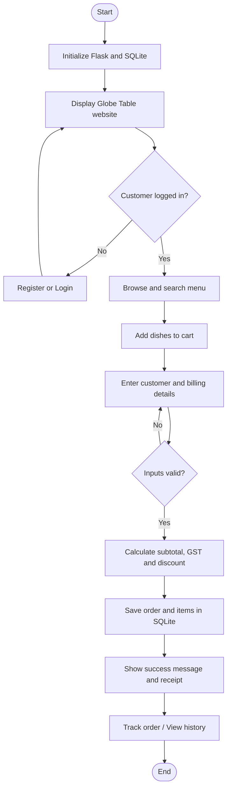

# Globe Table – Python Problem-Solving Capstone Project

## 1. Project title
**Globe Table – World Cuisine Restaurant Ordering and Management System**

## 2. Problem statement
Customers often need to browse a restaurant menu, calculate an order bill, provide delivery and billing details, place an order, and track its progress. Restaurant staff also need a simple way to manage menu availability, bookings, customer orders and sales records. This project provides one web application for these tasks.

## 3. Objective
Develop a working Python-based application that demonstrates problem identification, requirement analysis, input-process-output logic, database operations, validation, exception handling, reporting and a user interface.

## 4. Features
- Customer registration and login with hashed passwords.
- World-cuisine menu with search and cuisine/category filters.
- Shopping cart with quantity updates.
- Customer, delivery and billing details.
- Automatic 5% GST and optional `GLOBE10` discount (10%).
- Order placement, success confirmation and downloadable/printable text receipt.
- SQLite storage for customers, menu, orders, order items, reservations and party enquiries.
- Customer order history.
- Admin dashboard, menu add/delete/availability management and order-status updates.
- CSV sales/order report export.
- Reservation and private-party enquiry forms.
- Input validation, parameterized SQL queries and exception-safe database handling.

## 5. Technology requirements
- Python 3.10 or later
- Flask
- SQLite (included with Python)
- HTML, CSS and JavaScript
- Browser: current Chrome, Edge or Firefox

## 6. Installation and execution
1. Extract the ZIP file.
2. Open a terminal in the extracted `Globe_Table_Python_Project` folder.
3. Create and activate a virtual environment (recommended):
   - Windows: `python -m venv venv` then `venv\\Scripts\\activate`
   - macOS/Linux: `python3 -m venv venv` then `source venv/bin/activate`
4. Install packages: `pip install -r requirements.txt`
5. Run: `python app.py`
6. Open `http://127.0.0.1:5000` in a browser.

The SQLite database `globe_table.db` is created automatically on first run. On Windows, you can also double-click `run_windows.bat` (Python must be installed).

### Demo administrator
- Email: `admin@globetable.local`
- Password: `Admin@123`

Create a normal customer account through the website to place orders and bookings. Change the demo admin password and set a private `GLOBE_TABLE_SECRET` before deployment. GitHub Pages only hosts static files and cannot run this Flask/Python backend; upload the ZIP/source to GitHub for version control, then run it locally or deploy it to a Python-capable hosting service. The sample UPI/card options are only labels; no real payment is processed.

## 7. Input – Process – Output
| Input | Processing | Output |
|---|---|---|
| Customer registration details | Validate and hash password | Customer account |
| Menu item and quantity | Fetch current price and calculate subtotal | Cart amount |
| Customer and billing details | Validate, calculate GST/discount, save transaction | Order number and receipt |
| Reservation details | Validate date, phone and guest count | Reservation reference |
| Admin menu/status input | Update SQLite records | Updated menu/order status |
| Order records | Read database rows and write CSV | Downloadable report |

## 8. Algorithm
1. Start Flask application and initialize SQLite tables.
2. Load menu items from the database.
3. Customer registers or logs in.
4. Customer searches/filter menu items and adds selected items to cart.
5. Validate customer, delivery and billing details.
6. Calculate subtotal, GST (5%), applicable coupon discount and final total.
7. Save order and each order item in SQLite.
8. Display order confirmation and receipt.
9. Customer views order history; admin advances order status.
10. Admin can manage menu, review bookings and export CSV.
11. End.

## 9. Flowchart

## 10. Database design
- `users`: name, email, password hash and role.
- `menu`: dish name, price, category, vegetarian flag, cuisine and availability.
- `orders`: customer, address, billing, payment label, totals, status and timestamp.
- `order_items`: order reference, dish, unit price and quantity.
- `reservations`: guest details, date, time, guest count and reference.
- `parties`: event details, guest count, package and estimated cost.

## 11. Minimum Python concepts demonstrated
Variables and data types, input/output, operators, conditional statements, loops, functions, lists, tuples, dictionaries, string operations, file handling (CSV), exception handling, comments, modular functions and readable code.

## 12. Testing (sample test cases)
| Test | Input / action | Expected result |
|---|---|---|
| TC-01 | Register with valid name, email and 6+ character password | Account is created |
| TC-02 | Login with incorrect password | Error message; no login |
| TC-03 | Add two menu items and place an order with valid details | Order saved and receipt displayed |
| TC-04 | Place order with invalid phone number | Validation error; no order saved |
| TC-05 | Admin changes order status to Cooking | Updated status appears in admin view |

## 13. Screenshots to include in final report
Capture screenshots after running the project:
1. Home page and menu.
2. Customer registration/login.
3. Menu search and cart.
4. Checkout form with customer and billing details.
5. Successful order confirmation and receipt.
6. My Orders page.
7. Reservation confirmation.
8. Admin dashboard and menu management.
9. CSV report opened in Excel or a spreadsheet application.

Screenshots are intentionally not fabricated; capture them from your own running application.

## 14. MOOC learning source and progress evidence
The supplied guideline requires a selected free Python/CSE course, progress evidence and an explanation of how it supported the project. Add your actual course name, provider, course URL, completion/progress screenshot and the topics you completed here. This information was not present in the supplied materials, so it has not been invented.

Suggested free learning source: Python tutorial at https://docs.python.org/3/tutorial/ . Use a course you actually studied and attach genuine progress evidence.

## 15. Conclusion
Globe Table demonstrates how Python can solve a practical restaurant workflow problem. It combines a browser-based user interface with Flask routes and an SQLite database. Customers can register, explore dishes, place orders, receive billing details, track order status and reserve tables. Administrators can maintain the menu, process orders and export reports. The project applies core Python programming concepts together with database connectivity, validation and file-based reporting.
